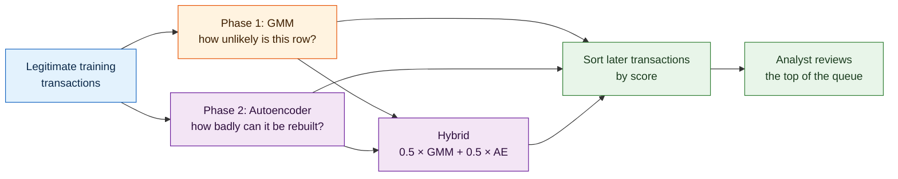
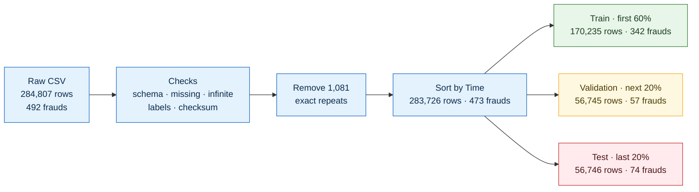
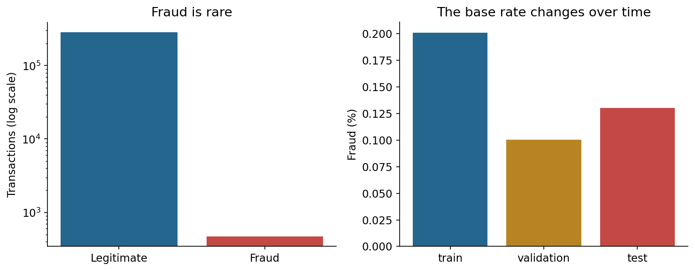
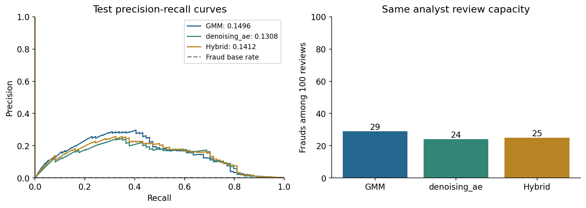

<div align="center">

# Card Fraud Triage

**Team T011 · Section A · Project 26**

Ranking unusual card transactions for human review, using models that only ever learn from legitimate spending.


</div>

Open the **[project website](https://mitul-bhatia.github.io/t011-card-fraud-phase1/)**. It is the single navigation page for both phases, their notebooks, results, reports, presentations and study guides. In a downloaded copy, open **[index.html](index.html)** locally.

| Folder | Work | Read or run |
|---|---|---|
| [phase1](phase1/README.md) | Machine learning: GMM density scoring | Read 01, then run 02–05 |
| [phase2](phase2/START_HERE.md) | Deep learning: autoencoder, hybrid and ablations | Read 00, then run 01–04 |

Each phase keeps its own `notebooks/`, `results/`, `figures/`, `report/`, `output/` and documentation. Executed HTML reading copies are in each phase's `output/notebooks/` folder. Final reports and presentations are in that phase's `output/` folder.

For Phase 2, begin with [deep learning in 10 minutes](phase2/output/DEEP_LEARNING_IN_10_MINUTES.html). It explains the autoencoder's input, target, weight updates, validation and measured results before introducing the hybrid.

---

## The idea in one picture

Fewer than 2 in every 1,000 transactions in this dataset are fraud, so nobody can check everything by hand. Instead of a yes/no answer, every transaction gets a **suspicion score** and an analyst reviews the highest scores first. Both models learn only what *normal* looks like; anything that fits normal badly scores high.



| Model | Score | High score means |
|---|---|---|
| **GMM** (Phase 1) | −log p(x) under a mixture of 8 Gaussians | The row is unlikely under normal behaviour |
| **Denoising autoencoder** (Phase 2) | Reconstruction error after compressing 29 → 8 → 29 | The network cannot rebuild the row well |
| **Hybrid** (Phase 2) | Average of both scores after robust normalisation | Both views agree the row is unusual |

The hybrid trains no extra network. Each score is compressed (`asinh` for GMM, `log1p` for AE), centred on its legitimate-validation median and divided by its interquartile range, then the two are averaged with fixed 0.5/0.5 weights. No weights are tuned on fraud labels.

---

## The data and the split

Both phases use the same [ULB/Worldline dataset](https://www.kaggle.com/datasets/mlg-ulb/creditcardfraud): two days of European card transactions with 28 anonymised PCA features (`V1`–`V28`), `Amount`, `Time` and the label `Class`. Phase 2 checks the SHA256 checksum against Phase 1, so both phases are guaranteed to read the identical file.



| Period | What it is used for |
|---|---|
| **Training** | Fitting the scaler, GMM and autoencoder, on legitimate rows only |
| **Validation** | Early stopping, hybrid normalisation and alert cutoffs, on legitimate rows only |
| **Test** | Final comparison of all models; its labels are never used for tuning |

The split follows time order so that models learn from the past and are scored on the future, as they would be in practice.

<p align="center">
  
</p>
<p align="center"><i>Left: fraud is a tiny fraction of all transactions (log scale). Right: the fraud rate is 0.20%, 0.10% and 0.13% across the three periods, so fraud does not arrive evenly over time.</i></p>

The dataset lives once at **`phase1/data/raw/creditcard.csv`**. Phase 2 reuses it and the Phase 1 baseline for a consistent comparison. Data, generated arrays and model files are excluded from Git and the portable package. Download the official CSV from the [ULB/Kaggle dataset page](https://www.kaggle.com/datasets/mlg-ulb/creditcardfraud) on a new machine.

---

## Measured result

The GMM has test PR area **0.1496**, the denoising AE **0.1308**, and the hybrid **0.1412**. Their first 100 reviews find **29, 24 and 25 frauds**. At the default validation policy, the hybrid makes **40 fewer false alerts** than the GMM while catching **two fewer frauds**. The test benchmark was already used in Phase 1; Phase 2 does not use its labels for tuning.

| Model | PR AUC | Frauds in top 100 | Default policy: caught / false alerts |
|---|---:|---:|---:|
| **GMM** | **0.1496** | **29** | 37 / 172 |
| Denoising AE | 0.1308 | 24 | 33 / 137 |
| Hybrid | 0.1412 | 25 | 35 / **132** |

<p align="center">
  
</p>

For scale: 100 randomly chosen test transactions would contain about **0.13** frauds. All three models do far better, and the GMM ranks best on this benchmark. The hybrid improves on the autoencoder and lowers false alerts, at a small cost in recall.

---

## Run the project

Use Python 3.12. From the repository root:

```bash
python3.12 -m venv .venv
source .venv/bin/activate
python -m pip install -r requirements.txt
python phase1/scripts/run_all.py
python phase2/scripts/run_all.py
python phase2/scripts/prepare_submission.py
python phase2/scripts/build_index.py
python phase2/scripts/check_deliverables.py
python phase2/scripts/package_project.py
```

To install only the ML dependencies, use `phase1/requirements.txt`. Each runner uses a fresh Python process for every notebook and refreshes the linked reading copies. You can also open the notebooks in VS Code or Jupyter and Run All in the same order.

For future full checks, use one command after installing dependencies and adding the CSV:

```bash
python phase2/scripts/verify_project.py --rerun
```

This reruns both phases and the separate exploratory GMM notebook, reloads model weights to check scores and cutoffs, checks the deliverables, rebuilds the ZIP and checks its extracted contents. Omit `--rerun` to check the current saved work. Logs stay in `.build/verification/`. See the [requirements and verification review](phase2/docs/VERIFICATION_REVIEW.md) for the remaining team actions.

---

## Team

| Member | Enrollment | Retained responsibility |
|---|---|---|
| H Maheshwari (Hardik) | 2401010174 | Evaluation and thresholds |
| Vaibhav | 2401010486 | Features and scaling |
| Mayank | 2401010267 | Model training; README and presentation with Keshav |
| Keshav | 2401010222 | Data quality and EDA; README and presentation with Mayank |
| Mitul Bhatia | 2401010279 | Overall project lead, integration and coordination |

All five jointly contribute to the report. Each member should record and explain their actual work in the [team record](phase2/docs/TEAM_ROLES.md).

The [complete portable package](phase2/output/Card_Fraud_Triage_Complete.zip) includes both phases and the shared index. The supplied [course instructions](CSAI_Project_Instructions_Phase_1_and_Phase_2.pdf) remain at the root because they apply to both phases.
