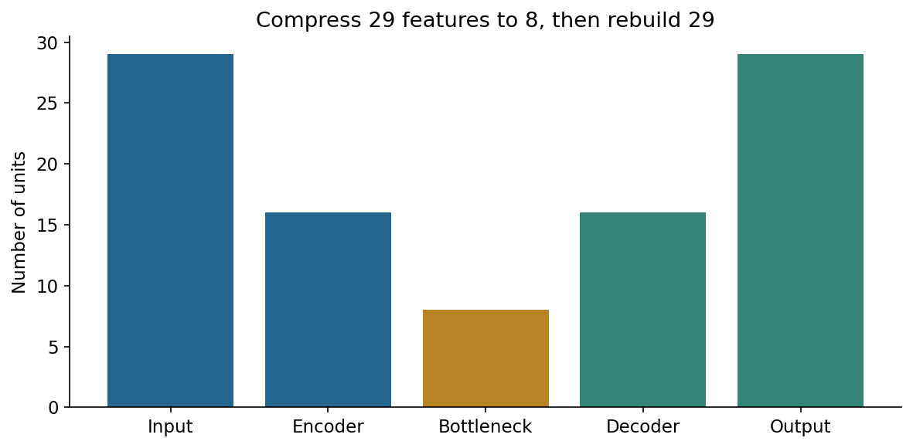
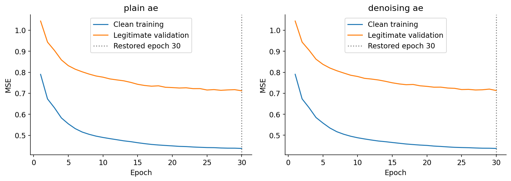

# Phase 2: deep learning in 10 minutes

**One sentence:** We train a neural network to rebuild legitimate card transactions, then use reconstruction error to prioritize unusual transactions for review.

Read this first. Notebook 03 contains the actual training code. The longer last-day guide is a reference after you understand this page.

## 1. What makes Phase 2 deep learning?

The autoencoder is a neural network with four learned Linear layers. Hidden ReLU activations let it learn nonlinear relationships. Backpropagation calculates gradients; Adam changes the weights to reduce reconstruction error. Our network has **1,253 trainable parameters**.

| Part | What it learns | Place in the project |
|---|---|---|
| GMM | Gaussian density patterns | Phase 1 ML baseline |
| Autoencoder | A nonlinear reconstruction function | Main Phase 2 DL model |
| Hybrid | No extra network; combines two scores | Extension after AE training |

The DL work includes architecture choices, training, validation, regularization, ablations and evaluation. The hybrid adds a comparison; it does not replace the autoencoder training.

## 2. What goes into the network?

One transaction becomes **29 scaled numbers**: V1-V28 and log(1 + Amount). These V-features are anonymous. We cannot translate them into business claims such as a stolen card.

```text
29 input values
    16 encoder units
        8 bottleneck units
    16 decoder units
29 reconstructed values
```

The encoder compresses. The decoder rebuilds. Eight is smaller than 29, so the bottleneck limits copying capacity. ReLU follows the hidden layers. The final layer stays linear because scaled values can be negative.



## 3. What are the input and target during training?

Only **169,893 legitimate training rows** update the weights. Class filters that subset; it is never an input feature or a reconstruction target.

| Item | Actual meaning |
|---|---|
| Clean row | The original 29 scaled values |
| Noisy input | Clean row plus small Gaussian noise, SD 0.10 |
| Target | The same clean row |
| Output | The network's 29 rebuilt values |
| Loss | Mean squared difference between output and clean target |

The model predicts feature values, rather than a fraud label. At scoring time we use clean inputs and add no noise.

Notebook 03 traces four real legitimate rows through the network just to show shapes: **(4, 29) input, (4, 8) compressed, (4, 29) rebuilt**. Real training uses batches of up to 1,024 rows. A shape demonstration shows the architecture; it is not a trained-model result.

## 4. What happens in one training update?

1. Take a batch of legitimate rows and add noise to its input.
2. Run the network to get reconstructions: the forward pass.
3. Compare those reconstructions with the clean targets using MSE.
4. Use `loss.backward()` to calculate how the weights affected the loss.
5. Use `optimizer.step()` to let Adam update the weights. Clear old gradients before each update.

For a small arithmetic example, original `[1, 2]` and rebuilt `[1.1, 1.8]` give MSE `(0.01 + 0.04) / 2 = 0.025`. The real model averages over 29 features and the batch.

An **epoch** is one pass through the training set. Learning rate 0.001 controls updates. Weight decay 0.00001 discourages large weights. Compression and noise also constrain learning.

## 5. How do we know it learned?

Across the main model's 30 epochs, clean training MSE falls from **0.7903 to 0.4373**. Legitimate-validation MSE falls from **1.0438 to 0.7130**. This shows improved reconstruction of normal data. Fraud detection still needs a separate check.



Validation rows never update weights. Their clean reconstruction error selects the checkpoint. The main model reaches the 30-epoch cap and restores epoch 30. The stopping rule can stop a run after five epochs without enough improvement; it does not stop every run early.

## 6. How does reconstruction become a fraud-review score?

For each later transaction, rebuild its 29 inputs and average the 29 squared differences. Larger MSE means the transaction was harder for this model to reconstruct.

Some frauds reconstruct well, and some unusual legitimate transactions reconstruct poorly. A high score is a reason to review a transaction, rather than proof of fraud.

The default cutoff is the 99.5th percentile of legitimate validation errors. Scores strictly above it create alerts. We apply that saved cutoff to the later test set. Its observed validation FPR budget is 0.5%; the future test FPR can differ.

## 7. What did the DL model achieve?

The same test period contains **56,746 transactions and 74 frauds**.

| AE result | Measured value | Meaning |
|---|---:|---|
| Trapezoidal PR area | 0.1308 | Summary of its precision-recall curve |
| Fraud among 100 reviews | 24 | 24% precision at that capacity |
| Fraud caught at default cutoff | 33 of 74 | 44.6% recall |
| Legitimate false alerts | 137 | Legitimate transactions sent for review |
| Total alerts at default cutoff | 170 | 33 frauds + 137 legitimate rows |

GMM finds 29 frauds in its top 100; AE finds 24; hybrid finds 25. Thus GMM ranks best here. Implementing DL correctly does not guarantee it beats ML.

The tested DL model does improve on the **linear PCA8 reconstruction reference**: PR area is **0.1308 versus 0.0712**, with **24 versus 6 frauds in 100 reviews**. Both compress to eight dimensions, but fitting procedures and parameter counts differ. This is a useful result for this nonlinear reconstruction experiment, rather than a general claim that DL always wins.

The ablations are useful DL findings: noise helps some measures, a wider bottleneck lowers normal loss but worsens fraud ranking, and a second seed gives weaker results. We keep these outcomes visible. Phase 1 already exposed this test period, so this is a reused benchmark; we do not tune Phase 2 on its labels.

## 8. A simple demo and viva answer

In notebook 03, show the network, the shape table, the five training actions and the loss curves. In notebook 04, show PR curves and one confusion matrix. Then explain one ablation. Use the detailed guides only for follow-up questions.

**Say this:** "Phase 2 trains a denoising autoencoder on legitimate transactions. It compresses 29 features into 8 and learns to rebuild the clean input using MSE, backpropagation and Adam. We select the checkpoint on legitimate validation data, then use reconstruction error to rank later mixed transactions. We compare it fairly with GMM and test a fixed hybrid. GMM remains stronger on this benchmark, while the DL experiments show what reconstruction learning can and cannot do."

## Check your understanding

- **What is the target?** The clean 29-feature transaction.
- **What changes during training?** The network weights and biases.
- **Why use a bottleneck?** To limit copying capacity.
- **Where do fraud labels enter?** Filtering known normal rows and evaluation; no fraud examples update weights.
- **What makes this DL?** A learned multilayer neural network trained by backpropagation.
- **Does the hybrid train a new network?** No; it combines GMM and AE scores.

[Open the complete last-day guide](LAST_DAY_STUDY_GUIDE.md) or [read the results in detail](RESULTS_EXPLAINED.md).
